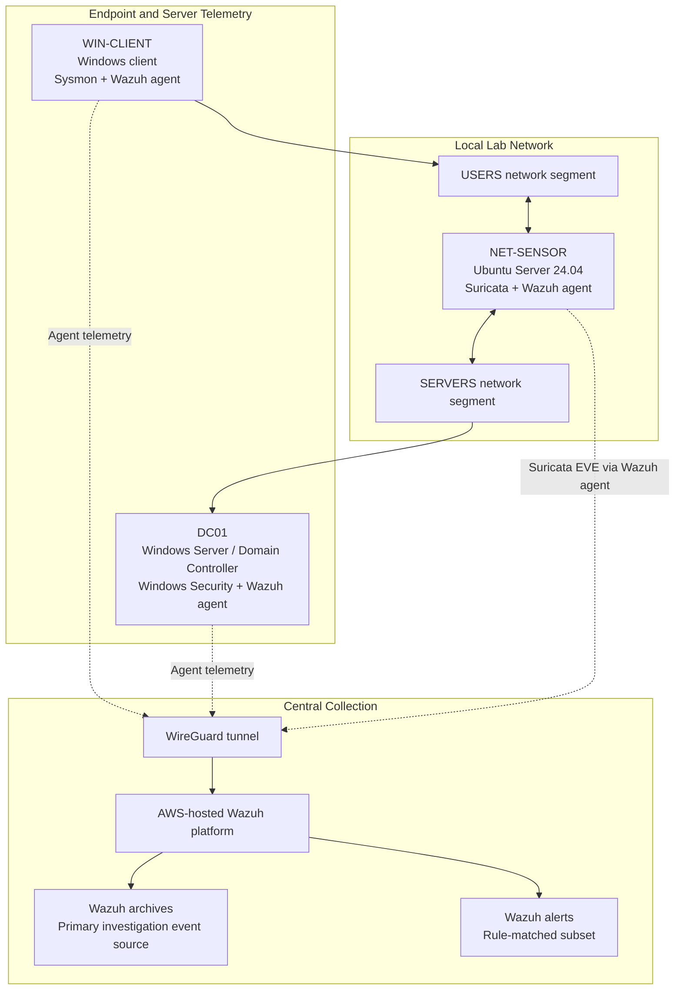

# Lab Architecture

**Documentation status:** Initial architecture baseline
**Historical handoff reference:** 2026-10-24

## 1. Purpose

This document describes the logical architecture of the SOC lab, its telemetry
sources, the network observation path, and the central collection platform.

It documents the lab foundation used by the separate
Cross-Telemetry Evidence Graph & Blast Radius Agent project.

This architecture is based on the available project handoff. It does not claim
that every component has been revalidated in the current session.

## 2. Logical Architecture

This is a logical overview, not a substitute for live network or firewall
validation.

## 3. Major Components

| Component | Responsibilities |
|---|---|
| WIN-CLIENT | Windows endpoint used for domain, process, DNS, and network scenarios |
| DC01 | Active Directory and DNS services; source of Windows Security events |
| NET-SENSOR | Routes and observes traffic between USERS and SERVERS; runs Suricata |
| Suricata | Generates network telemetry in EVE JSON format |
| Wazuh agents | Forward configured endpoint or sensor logs |
| WireGuard | Encrypted communication path between the sensor environment and AWS |
| Wazuh platform | Central event collection, indexing, searching, and alert generation |
| Wazuh archives | Primary source for investigation snapshots |
| Wazuh alerts | Subset of events matching configured detection rules |

## 4. Network Segmentation and Observation

The lab has separate USERS and SERVERS network segments.

NET-SENSOR has three virtual network interfaces and a WireGuard interface:

| Interface | Documented role |
|---|---|
| ens33 | VMware NAT/uplink network |
| ens34 | USERS network |
| ens35 | SERVERS network |
| wg0 | WireGuard tunnel toward AWS Wazuh |

The sensor observes routed traffic between USERS and SERVERS. The design does
not depend on VMware promiscuous mode to capture traffic between those segments.

Detailed operational IP addresses and routing configuration are intentionally
omitted from this public-safe overview.

## 5. Telemetry Flow

### 5.1 Windows endpoint events

WIN-CLIENT produces Sysmon and Windows endpoint telemetry. Its configured
Wazuh agent forwards selected event sources to the central platform.

### 5.2 Domain controller events

DC01 provides Windows Security events associated with authentication and
resource-access activity, in addition to Active Directory and DNS services.

The live collection policy must be checked before changing agent configuration.

### 5.3 Network telemetry

Suricata writes EVE JSON telemetry to:

`/var/log/suricata/eve.json`

The configured Wazuh agent on NET-SENSOR monitors this source. Network
telemetry can then be searched alongside endpoint and Windows Security events.

### 5.4 Central storage and alerts

Wazuh archives are the primary source for investigation snapshots. Wazuh alerts
contain events matching configured detection rules and are not a complete
replacement for archives.

The absence of an alert does not establish that no relevant event was collected.

## 6. Documented Validation Scenarios

The project handoff records these historical test results:

- **DNS:** Sysmon and Suricata observations were correlated during a controlled
  query. The documented response did not contain an A-record answer.
- **HTTPS:** Endpoint DNS and network activity were observed alongside a
  Suricata TLS flow. A complete process-to-file-hash evidence chain was not
  established.
- **Authentication and SYSVOL access:** Windows Security events 4624 and 5145
  shared relevant logon context during the tested scenario.

These observations do not prove malicious activity, compromise, or successful
lateral movement.

See `TELEMETRY_MATRIX.md` for the status and limitations of each telemetry path.

## 7. Current Boundaries and Deferred Components

The current documented scope does not include:

- A dedicated WEB01 server scenario
- Zeek network telemetry
- Velociraptor integration
- Threat-intelligence API integration
- Automated containment or response
- Cloud telemetry beyond the Wazuh hosting role

These components remain deferred until explicitly implemented and validated.

## 8. Evidence and Privacy

- Do not store credentials, private keys, API tokens, or secrets in this repository.
- Do not commit raw telemetry, packet captures, or unredacted investigation snapshots.
- Use sanitized screenshots and synthetic or sanitized fixtures for public PoC evidence.
- Record what each screenshot or test output demonstrates and what it does not.
- Preserve original evidence separately when required.
- Review all files before committing, even when `.gitignore` rules exist.

## 9. Relationship to the Agent Project

The companion agent repository is responsible for data contracts, event
normalization, deterministic relationship analysis, coverage assessment,
investigation outputs, and evaluation against independent ground truth.

This repository documents the telemetry foundation and validation procedures.
The agent repository should consume only the data needed for a case, with
provenance recorded and sensitive fields sanitized where appropriate.
