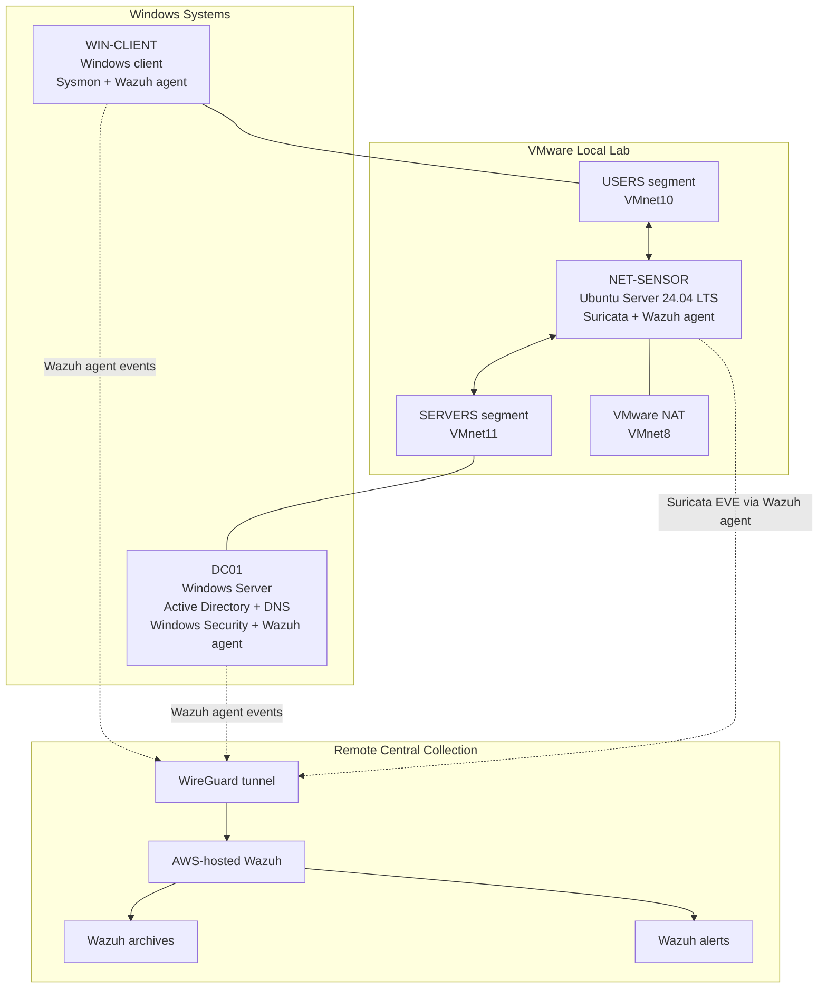

# Lab Topology

## 1. Purpose and Scope

This document describes the logical topology of the SOC telemetry lab and
the intended paths for network traffic and security-event collection.

The topology reflects the documented design. It is not, by itself, proof
that every interface, route, tunnel, agent, or service is currently healthy.

## 2. Logical Topology

## 3. Network Segments

| Segment | Virtual network | Intended role |
|---|---|---|
| NAT / external connectivity | VMnet8 | Provides the documented VMware NAT connectivity for the sensor. |
| USERS | VMnet10 | Contains the Windows client. |
| SERVERS | VMnet11 | Contains the domain controller and is reserved for server-side lab systems. |
| WireGuard overlay | `wg0` on the sensor and remote Wazuh host | Carries the configured private tunnel traffic between the local lab and central collection. |

Operational IP addresses and cloud identifiers are intentionally omitted
from this public-safe topology document. Keep any detailed operational
addressing inventory in a separate private document that is not committed.

## 4. Component Responsibilities

### WIN-CLIENT

- Generates endpoint telemetry through Sysmon.
- Runs a Wazuh agent to forward configured event sources.
- Is used for controlled process, DNS, network, and authentication-related tests.

### DC01

- Provides Active Directory Domain Services and DNS for the lab domain.
- Generates Windows Security events relevant to authentication and share-access auditing.
- Runs a Wazuh agent to forward configured event channels.

### NET-SENSOR

- Runs Ubuntu Server 24.04 LTS.
- Routes and observes traffic between the USERS and SERVERS segments according to the documented design.
- Runs Suricata and writes EVE JSON telemetry.
- Runs a Wazuh agent configured to forward the Suricata event source.

The sensor's visibility depends on traffic traversing the sensor. Do not
assume that it observes all traffic on the VMware host or every virtual
network.

### Central Wazuh Platform

- Receives configured endpoint and network-sensor telemetry.
- Stores collected events according to its active configuration and retention policy.
- Exposes archives for investigation and alerts for events matched by rules.

Wazuh alerts are not equivalent to the complete event population in archives.

## 5. Telemetry Paths

| Path | Expected content | Validation note |
|---|---|---|
| WIN-CLIENT to Wazuh | Configured Sysmon and other enabled event sources | Recheck current agent health and event delivery before a demonstration. |
| DC01 to Wazuh | Configured Windows Security event channels | Historical tests confirmed selected authentication and share-access events. Recheck current delivery. |
| NET-SENSOR to Wazuh | Suricata EVE JSON through the Wazuh agent | Recheck the configured log source and central receipt. |
| USERS to SERVERS through NET-SENSOR | Routed traffic available for network inspection | Visibility is limited to traffic that traverses the sensor. |
| Wazuh archives to investigation workflow | Retained collected events | Confirm the relevant records exist before using them as evidence. |

## 6. Security Boundaries

- The local lab networks are separated into USERS and SERVERS segments.
- The sensor is intended to provide routed observation between those segments.
- WireGuard provides the documented private tunnel path to the remote Wazuh platform.
- Do not expose the Wazuh dashboard or indexer publicly merely to simplify lab access.
- Do not store private keys, credentials, API tokens, or other secrets in this repository.
- Do not publish raw telemetry, unredacted screenshots, or sensitive operational inventories.

## 7. Deferred Components

The following are not represented as deployed capabilities of the current MVP:

- Zeek network monitoring.
- WEB01 and web-server telemetry.
- Cloud telemetry collection.
- Velociraptor endpoint collection.
- Threat-intelligence integrations.
- Malware sandbox integration.
- Automated response or SOAR.

Update this document only after a component is implemented and its relevant
behavior has been validated.

## 8. Validation Checklist

Before relying on the topology for a new investigation or public demonstration:

- [ ] Verify the current VM network adapters and segment assignments.
- [ ] Verify the sensor interfaces, addresses, routes, and forwarding behavior.
- [ ] Verify WireGuard peer status and the intended route scope.
- [ ] Verify Wazuh agent health on WIN-CLIENT, DC01, and NET-SENSOR.
- [ ] Verify recent source events arrive in Wazuh archives.
- [ ] Verify Suricata EVE events are being forwarded and received.
- [ ] Record test timestamps, evidence references, and limitations.
- [ ] Review the document for operational identifiers before publication.
